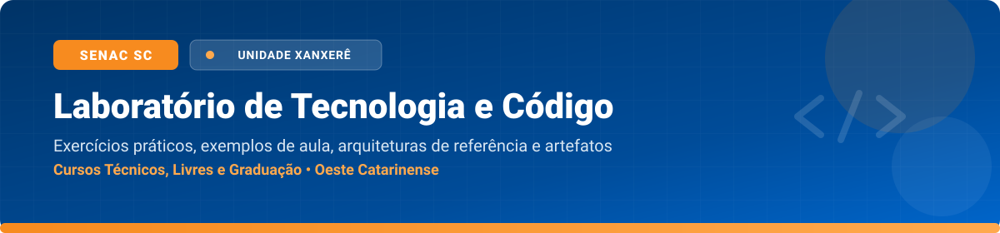

  

 

  
  
  

---

### 👋 Bem-vindo ao GitHub do Senac Xanxerê

Este espaço funciona como o laboratório prático de desenvolvimento de software da unidade **Senac Xanxerê (SC)**, centralizando códigos-fonte desenvolvidos em sala de aula, desafios de programação e modelos de projetos para as turmas de Tecnologia da Informação.

---

### 📂 O que você encontra por aqui

* **💻 Exercícios e Listas Práticas:** Desafios progressivos de lógica de programação, algoritmos, estruturas de dados e resolução de problemas reais.
* **🧩 Exemplos de Aula:** Códigos comentados e aplicações demonstrativas construídas ao vivo durante as unidades curriculares.
* **🏗️ Arquiteturas de Referência:** Estruturas base de projetos (APIs RESTful, aplicações Web Full Stack, bancos de dados relacionais e integração com IA).
* **📐 Artefatos e Documentação:** Diagramas, modelagens de banco de dados, protótipos, coleções de testes e templates para Projetos Integradores.

---

### 🛠️ Stacks & Ferramentas Utilizadas nas Turmas

  
  
  
  
  
  
  
  
  
  
  
  

---

### 💡 Dica para Estudantes

Para acompanhar as aulas e desenvolver seus projetos com ferramentas profissionais gratuitas (IDEs da JetBrains, GitHub Pro, créditos em nuvem e assistentes de IA), confira o [**Guia de Licenças Estudantis do Senac SC**](https://github.com/senacsc/student-licenses) utilizando seu e-mail `@alunos.sc.senac.br`.

---

  Mantido pelos docentes e estudantes de Tecnologia da Informação • <strong>Senac Xanxerê — SC</strong>

